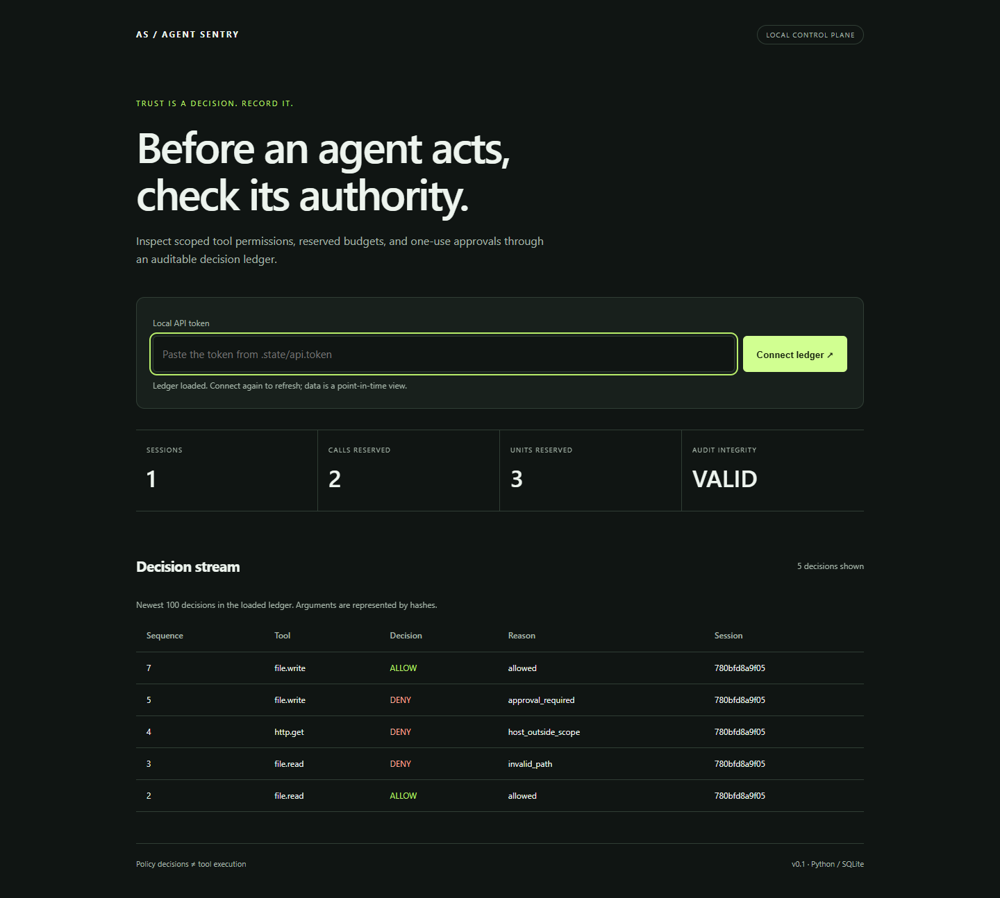
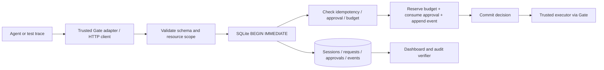

# Agent Sentry

**A local authorization control plane for agent tool calls—with atomic budgets, exact-argument approvals, and a replayable decision ledger.**

An agent asked to summarize a document might attempt to read a private path, contact an unapproved host, or repeat a write after a retry. Agent Sentry checks structured tool calls against an immutable session policy before a trusted executor acts. It demonstrates the backend engineering behind an AI safety boundary without requiring a model subscription or API key.



## What works

- Default-deny tool registry: virtual file reads/writes, HTTPS requests, and email recipients.
- Exact resource scopes; file roots use segment boundaries rather than string-prefix matching.
- Operator-issued approvals bound to the session, tool, and canonical arguments; expire and can be consumed once.
- Fixed policy-defined cost units and call limits reserved in a SQLite transaction.
- Persistent idempotency keys: retries return the original decision; changed inputs return a conflict.
- Hash-linked audit events with argument digests instead of plaintext bodies.
- Authenticated loopback HTTP API, a responsive dashboard, a Python integration adapter, and a deterministic demonstration.
- 24 authored policy scenarios, plus unit, concurrency, rollback, and real HTTP integration tests.

**Scope:** this is a development control plane and integration example. It does not run an LLM, implement MCP, sandbox arbitrary code, or detect every prompt injection. Enforcement requires trusted executors to use the adapter and preserve its resource semantics. See the [threat model](docs/THREAT_MODEL.md).

## Run in two minutes

Requires Python 3.11+ with SQLite support. There are **no third-party runtime dependencies**. From the repository root:

```bash
python -m unittest discover -s tests -v
python -m agent_sentry eval --output examples/eval-results.json
python -m examples.guarded_agent
python -m agent_sentry demo
python -m agent_sentry serve
```

Open **http://127.0.0.1:8765**. The server prints the path of `.state/api.token`. Read that local file and paste the token into the dashboard. Click **Connect ledger**. The token is held in page memory; it is not stored in browser storage or the URL. Press Ctrl+C in the server terminal to stop it.

On Windows, use `py` instead of `python` if needed. Run commands from the repository root so the example paths resolve. `demo` adds a new synthetic session each time; it does not read/write real tool files, send emails, or fetch external URLs.

The separate `examples.guarded_agent` command executes registered **in-memory** read/write tools. It verifies the actual synthetic workspace state after an approved write and demonstrates that a traversal attempt never reaches the executor.

## Architecture



Authorization is atomic. External execution happens after the authorization transaction and is **not** atomic with it. The adapter refuses to execute a replayed reservation and propagates executor failures; a failed execution retains its charge. It makes no exactly-once delivery guarantee. [Design decisions and failure semantics](docs/ARCHITECTURE.md)

| Module | Responsibility |
| --- | --- |
| `policy.py` | Strict policy schema, canonical JSON, resource scopes |
| `store.py` | SQLite transactions, approvals, reservations, idempotency, audit chain |
| `gate.py` | Check authorization before invoking a registered Python callable |
| `server.py` | Bearer-authenticated local API and static dashboard assets |
| `replay.py` | Isolated, deterministic scenario evaluation |
| `web/` | Dashboard; DOM values rendered with `textContent` |

## Define a session

The example policy permits reads under the virtual `workspace` root, HTTPS requests to `docs.example.org`, and approved writes or emails. It allows five calls and eight cost units. Units are configured weights, **not measured token usage or currency**.

```bash
python -m agent_sentry session --policy examples/policy.json
```

The returned session ID is used in API calls. Policies are stored as immutable JSON snapshots; changing the JSON file does not change existing sessions. Create a new session to apply a new policy.

```json
{
  "session": "SESSION_ID",
  "request_id": "read-brief-1",
  "tool": "file.read",
  "arguments": {"path": "workspace/brief.md"}
}
```

Send this JSON to `POST /v1/authorize` with `Authorization: Bearer <local token>` and `Content-Type: application/json`. The [API guide](docs/API.md) includes a runnable Python client, all endpoints, response semantics, and approval instructions.

## Verification

```bash
python -m unittest discover -s tests -v
python -m agent_sentry eval --output examples/eval-results.json
python -m agent_sentry verify
```

The authored suite covers benign calls, traversal variants, hostname confusion, recipient exfiltration attempts, authority changes, approval swaps/reuse/expiry, quotas, and retries. Its expected answers were written alongside the implementation. Passing it proves regression behavior on these cases; it is **not** a measured attack-success rate against real models. Full per-case output: [eval-results.json](examples/eval-results.json).

Tests also race 16 independent database connections against a five-call budget, race ten requests for one approval, and inject an audit-write failure to verify that the approval and charge roll back together. [Actual local verification record](docs/VERIFICATION.md)

GitHub Actions runs lint, formatting, tests, scenario replay, and an installed-package smoke check on Linux and Windows. CI status must be checked on the PR; a workflow file alone is not a passing run.

## Research and interview preparation

- [Research, alternatives, placement value, and four-project roadmap](docs/RESEARCH.md)
- [Architecture and tradeoffs](docs/ARCHITECTURE.md)
- [Threat model and limitations](docs/THREAT_MODEL.md)
- [Five interview questions, walkthrough, and evidence-based resume wording](docs/INTERVIEW.md)

## Limitations and next milestones

This version targets one trusted local operator, a small ledger, and cooperating tool executors. SQLite serializes writes. Requests and audit events require an operator retention plan. The UI loads events in pages but has no live streaming. No production hosting, authenticated multi-tenancy, DNS pinning, filesystem isolation, cancellation/refunds, or real-model evaluation is claimed.

The next milestones are an executor result/reconciliation protocol, externally anchored audit checkpoints, property-based/fuzz testing, and an MCP adapter with explicit redirect and filesystem protections. Each needs its own tests and threat-model review.

MIT licensed. Built with AI assistance; repository history and verification evidence describe the implementation rather than claiming independent review or production adoption.
